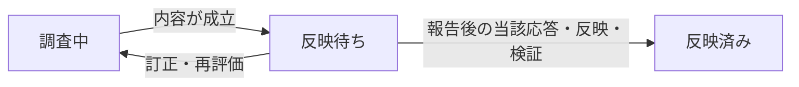

# AIが導く変更

[全体設計へ戻る](../design.md)

facilitate-discussionが、利用者の判断を求める提案と、合意・委任からAIが具体化する変更を区別する。
質問を減らしながら、根拠・変更前後・反映状況を追える記録を残す。

## 何を利用者へ問うか

既存の原因担当の診断・振分けを行った後、今回必要な処理を分類する。

| 条件 | 進め方 |
| --- | --- |
| 成果・後続に実質差がある複数案、未決の価値・優先順位、利用者だけが持つ情報・権限、意図の解釈の疑義 | 通常の提案として問う |
| 合意と確認済み制約から、意味を変えずに別の結果を選べない | 合意からの導出として記録 |
| 明示的に任された範囲で複数の方法から選べる | 明示委任として比較・選定理由を記録 |
| 意味・外形を変えない転記、表記統一、同じ参照先へのlink修正 | 新論点なしで適用 |

調べて埋まる不足は先に調べる。複数案は小文字a〜eで差と推奨理由を示し、一案なら採否を問う。
数合わせの不成立案、閉じた採否の再確認、AIの確信を根拠にした自動採用は行わない。
一般規則の不足を局所変更で覆わず、未合意の負担・運用方針は利用者の判断へ戻す。

## 変更を記録し、報告してから反映する

導出・委任でも通常と同じ論点番号とiterationを使い、種別と判断根拠を混ぜない。
根拠、契約の担当、理由、影響範囲が異なり独立して戻せる変更は別論点にする。
不可分な修正と必須のhref追従は一緒に扱う。

| 記録する場所 | 内容 |
| --- | --- |
| 変更内容I（論点N） | 判断根拠、合意・委任の出典と範囲、変更前後、変更後の完全な対象範囲、理由・影響先。委任なら比較・選定理由 |
| 検討記録と同番号の内部log | 判断に必要な背景と、回ごとの詳細な検討過程 |
| 現在の変更（論点N） | 現在の回、根拠、報告した実際の問い・完了reviewと版、対象、応答の所在、反映・検証結果、未完理由 |

利用者向けの記録はsessionを見ずに判断できる内容にする。
空feedbackや架空のokは作らず、実際の応答・訂正だけを原文保存する。
通常提案の応答欄と状態は維持し、別番号体系・台帳・統合確認論点・常設summary・過去記録の一括変換は追加しない。



未報告・応答待ち・適用条件不足は、反映待ちの中の事実として記す。
部分反映や検証失敗では成功部分と残件を残し、全体を反映済みにしない。既存の外的要因による保留も維持する。
反映先がdesignなら設計同期の完了であり、plugin実装・配布全体の完了ではない。

次の利用者decisionまたは完了reviewの直前に、未報告の変更をsessionでまとめて報告する。
論点番号と記録先、どこを・なぜ・どう変えるか、他変更との相互作用を伝え、成果物はまだ未反映と明示する。
summaryへの追加okは求めず、次の当該作業への応答後に、元の合意・委任と現在の権限・依存・validation条件に従って適用する。
時間経過や別件の発話を開始の合図にしない。明示合意した通常decisionと意味不変の機械適用は、この待機の対象外。

内容が変わった新しい回へ旧回の報告実績を流用しない。
中断後は現物と記録を照合して二重適用を避ける。
独立した確定作業は進めるが、依存する後続と完了宣言は反映・検証まで待つ。

## 訂正を受けた時

応答の原文とAIの解釈を分け、対象変更・報告した版・原因の担当を特定する。
同じ変更は同じ論点の後続iteration、別の独立decisionは新論点へ残す。
複数変更にまたがる応答は原文の所在と各解釈を結び、架空の個別の賛成へ分割しない。

利用者が完成形を一意に指定した訂正は、同じ採否を聞き直さず明示指示として扱う。
AIが別内容を再導出・再選定した場合は、新しい回を報告して次の当該応答を待つ。
利用者の判断が残る箇所は通常提案へ戻す。

変更と依存先だけを止め、元の根拠・現物・影響を再確認する。
訂正と次の問いへの選択が同時に来ても、変わった前提へ回答を流用しない。
反映後の誤りは現在結果へ再評価の必要を残し、修復・再検証後に後続を再開する。
過去履歴や利用者の変更を守り、無断の一括rollbackは行わない。

## 記入例

架空の例であり、実際の合意・検証ではない。実物には対象path・節と根拠原文・内部logへのlinkを付ける。

```markdown
#### 変更内容0（論点N）

**判断根拠:** 合意からの導出

合意済みの「分割後の入口を一つにする」に従い、案内文の参照を同名索引へ揃える。
変更対象は読取入口と参照先。原文・採番・承認条件は保持する。

#### 検討記録（論点N・イテレーション0）

参照先と更新対象を照合し、旧入口と新入口の共存を作らないことを確認した。
内部検討記録の対応する回へ接続する。

### 現在の変更（論点N）

イテレーション0。対象は案内文。
未報告・未反映。次の問いまたは完了review直前に報告し、その作業への次の応答後に適用する。
```

報告後は実際の問いと回、次の応答の所在へ更新し、適用後は対象と検証結果を記す。

## 実装するfileと接続

`plugins/tumeda-dev/skills/facilitate-discussion/` 内を更新する。
SKILL.mdは原因担当の判定後に上の分類を行い、通常提案をiteration.md、導出・委任を新設derived-change.mdへ渡す。
derived-change.mdの見出しは「根拠と範囲を確定する」「個別の変更内容を記録する」「次の問いの前に報告する」「応答・訂正後に反映する」。
既存の内部検討手順を共用し、原因判定や検討formatを別実装しない。
templates/discussion_entry.mdには変更内容・現在の変更の部品と例を追加する。think-throughの標準は変更しない。

調査中・反映待ちのAI変更も親の未完childへ数える。
全childが通常decisionの決定またはAI変更の反映済みなら、親を分解済みにする。
原文読取にも現在の変更と未完の最新iterationを含める。helperは意味的な合意・反映済み認定を代行しない。
索引への状態複写や、引き継ぎ時の全履歴読取の省略は行わない。
