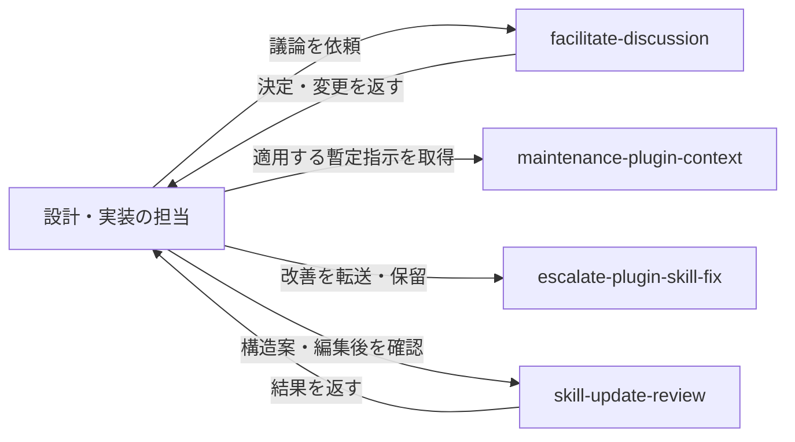

# Design: 保留解除したplugin改善を受け入れる

## 元の依頼内容

escalate対象いるよね

だよね。続けて

提案と具体例の出典は[引き渡し入力](./handoff-input.md)に残す。
利用先での合意と、pluginへ組み込む設計の合意は区別する。

## この変更で実現すること

長い議論を必要な範囲で読み、AIが具体化できる内容は採否確認を繰り返さず進められるようにする。
その間に見つかったplugin改善は、利用者の指示に従って保留できる。
保留中の作業で必要な暫定ルールと、skillを育てる際の構造reviewも用意する。

変更は次の四領域。議論・設計・実装の担当は維持し、それぞれが必要な共通処理を呼び出す。

| 領域 | 利用者から見た変化 | 担当skill |
| --- | --- | --- |
| 議論の保存と読取 | 長くなっても履歴を辿り、過去の論点から再開できる | facilitate-discussion |
| AIが導く変更 | 判断が必要な箇所だけ問い、具体化した差分は記録・報告される | facilitate-discussion |
| 改善の保留と暫定運用 | 改善を後回しにしつつ、今の作業に必要な指示を管理できる | escalate-plugin-skill-fix / maintenance-plugin-context |
| skillの構造review | 肥大化や分割漏れを、設計時と編集後に確認できる | 新設するskill-update-review |

## 完成後の使い方

### 長い議論を続ける

一つの議論が10論点を超えたら、5論点単位の本文と索引へ分割する。
通常は全体の現在状態と、今扱う範囲の履歴を読む。過去の提案・応答・決定は記録に残す。
10論点以下の記録は従来の場所に残す。

別の担当へ設計を引き継ぐ時は、従来どおり先に独立再構成する。
その後は分割先も含む全履歴と照合するため、通常進行での読取削減を引き継ぎの省略には使わない。

保存形式・移行・読取専用scriptは[議論の保存と読取](./design-details/discussion-records.md)に定める。

### AIが具体化できる変更を進める

未決の価値判断、利用者だけが持つ情報・権限、意図の解釈に疑義がある箇所は利用者へ問う。
合意から一意に導ける変更と、明示的に任された範囲の具体化は、AIが根拠・変更前後・理由を個別に記録する。
たとえば入口を一つにする合意から参照先を揃える場合、その採否を何度も聞き直さない。

AIが記録した変更は、次の問いや完了reviewの前にまとめて報告する。
当該作業への次の応答を受けて反映・検証し、訂正が来たら影響する後続を見直す。
これにより、質問を減らしながら「いつ、なぜ、何が変わったか」を追える。

判断の分類・報告待ち・訂正の扱いは[AIが導く変更](./design-details/derived-changes.md)に定める。

### 改善を保留し、その作業だけの暫定ルールを使う

「この改善は後で」と明示されたら、提案と保留条件を元作業へ保存する。
「設計が終わったら渡して」なら完了の証拠を確認して再開し、「終わったら聞いて」なら回答を待つ。
plugin側が受領したら、その作業記録へ接続する。

保留中に「今の作業ではこう進めて」と指示された場合は、改善提案とは別に暫定指示を保存する。
作業を再開したskillは、自分に適用する指示をmaintenance-plugin-contextから受け取る。
実行pluginのversionが変われば継続を確認し、作業完了や正式版による全面代替などで終了する。

保留メモは「後で渡す提案」、暫定指示は「今の動作を決める指示」である。
前者の引き渡しだけで後者を成立・終了させない。どちらも別作業へ持ち込まない。

記録形式と再開は[改善の保留](./design-details/pending-escalations.md)、
適用・競合・終了は[暫定指示](./design-details/temporary-overrides.md)に定める。

### skillの構造を確かめる

汎用skillを新設・更新する時は、構造案を採用する前と、skill-creatorで編集した後にskill-update-reviewを使う。
長さではなく、処理ごとの判断・状態・完了条件・改訂理由から、一fileの維持、内部指示への分割、別skillへの独立を判断する。

たとえば固有の状態と再開条件を持つ復旧工程は内部fileへ分ける。
同じ処理で値を切り替えるだけなら、その違いだけでは分けない。
結果は根拠付きで元の設計・編集担当へ返し、不合格や材料不足を残したまま通常完了にはしない。

評価範囲・判定基準・結果の保存は[skill構造review](./design-details/skill-update-review.md)に定める。

## 責務と接続

議論の記録はfacilitate-discussion、決定の設計への反映はtask-design、
実装と完了判定は既存の実装担当が持つ。記録やcheckboxの書込み担当を増やさない。

| 接続箇所 | 一緒に保つ条件 |
| --- | --- |
| 読取処理とAI変更 | 現在の変更・未完の回を取得し、親の未完判定と一致させる |
| 議論の入口と設計引き継ぎ | 存在確認と本文読取を分け、独立再構成前の本文禁止を守る |
| 暫定指示の管理と各skill | 選択・競合・版の判断を管理担当へ集約する |
| 構造reviewと設計・実装 | 結果を既存記録へ保存し、既存の合意・機能・安全の検証へ戻す |

保留メモと暫定指示は別々に利用でき、構造reviewも議論の特定の保存形式を要求しない。
共通処理を実装しただけでは完了せず、呼出し側が入力・停止理由・結果を扱えることまで確認する。

## 成果物と変更範囲

実装する内部指示、script、templateと、その呼出し箇所は各詳細文書の「実装するfile」にまとめる。
pathは `plugins/tumeda-dev/skills/` を基準とする。

- facilitate-discussion: 保存場所の解決、原文読取、分割移行、AI変更を内部指示へ分ける。
- escalate-plugin-skill-fix: 即時転送の前に明示保留を判定し、保留と再開の内部指示・templateを加える。
- maintenance-plugin-context: 安定したrepositoryの事実と暫定指示を分け、後者の管理処理・templateを加える。
- skill-update-review: 入口、材料収集、構造評価、結果template、UI metadataを新設する。
- task-design、steering、tasklist-executorなど: 上記処理を既存の開始・再開・終了・reviewへ接続する。

暫定指示の取得導線は、現存する全skillのSKILL.mdと新skillの入口が対象。
各skillの個別workflow全体を再設計する範囲へは広げない。

## 必達条件と対象外

四提案の内容・具体例・根拠を保持し、利用先固有の情報を公開pluginへ持ち込まない。
転記や整理に未合意の意味変更を混ぜず、既存の設計引き継ぎ改善の作業を重複して作らない。

利用先の記事用skillの移植、四領域の巨大な共通skill化は対象外。
既存のextract-handoff-input.mjs、外部のskill-creator、think-throughの思考標準は変更しない。
設計文書の同期だけで本体・version・既存案件のcheckboxを変更しない。

## 受け入れ基準と検証

以下は実装後の確認条件であり、実行済みの結果ではない。
各詳細文書の通常・失敗・訂正・中断復帰の条件と合わせて確認する。

| 領域 | 代表的な確認 |
| --- | --- |
| 議論記録 | 10件と11件、旧h3、例示、欠落・重複・親循環、移行中断、原文改変を区別する |
| AI変更 | 未報告、応答待ち、部分反映、訂正、新しい回を区別し、架空の合意を作らない |
| 保留 | 条件付き再開と解除待ち、訂正、転送失敗を扱い、受領前は引渡し済みにしない |
| 暫定指示 | 指示なしと取得不能、別作業、競合、版更新、部分・全面代替を区別する |
| 構造review | 一責務と独立工程、二重定義、未読資料、再review、版差、呼出し経路を確認する |

既存能力を移動・分割する前にbaselineを保存し、能力と配置の二層のmigration ledgerで更新前後を照合する。
指示本文の読解に加え、隔離した記録での独立した動作検証と呼出し境界の確認を行う。
文字列・link・hashの一致は、判断能力・機能・安全の検証を代替しない。

分割scriptの自己testは `node --test plugins/tumeda-dev/skills/facilitate-discussion/scripts/inspect-discussion.test.mjs`。
全体検証は `node scripts/verification/validate-plugin.mjs`。linterはない。
Markdownはdocument-reviewを通し、適用するskill-creatorの独立した動作検証も省略しない。
配布metadataの更新はmaintenance-plugin-contextの既存規約に従う。

## 変更の実行区分

### task-design内で対象成果物へ適用済み

なし。

### task-design内の対象成果物反映待ち

なし。

### execution plan対象

| 対象 | 掲載理由 | 参照するdesign section |
| --- | --- | --- |
| 四領域のplugin改善、呼出し側への接続、配布metadataの整合 | 中間checkpointと独立した動作検証が必要 | 完成後の使い方、責務と接続、受け入れ基準と検証、各詳細文書 |

能力baselineの確保、共通処理の検証、呼出し側との接続確認、独立した実行と修正後の再検証を区切って進める。
保存・読取の権限や完了条件を変えるため、一続きの書換えと文書reviewだけで完了させない。

新たな子設計を必要とする不確実性はなく、一つのtasklistへ落とすleafとして扱う。
設計全体のreview後にplanを設計する。roadmapは併置しない。
本体実装・配布は未実施であり、設計整理を実装開始・公開・commitの指示とは扱わない。
