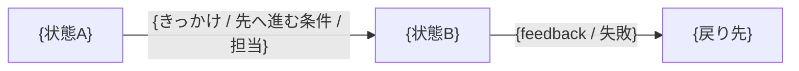

### 作業の流れと担当

<!--
移行元:
- task-design/SKILL.md「成果物template」「Step 3〜6」
- roadmap-design.md「Field ownership」
- steering/SKILL.md「役割とゴール」「Flow」

単に「Aの後にBを行う」と書くのではなく、担当、同じfileへ書き込む担当を一つにすること、正とする記録、
先へ進む条件、停止・再開、引き継ぎを合わせて、完成後の作業の流れを描く。

なぜ必要か:
- 個別のfileが正しくても、呼び出す側と結果を受け取る側の境目で、利用者の確認、停止、返す結果が落ちるため。
- 二つの担当が同じ項目を更新して正とする記録が二つになることや、誰も更新しない責務の穴を防ぐため。
- うまくいく場合の流れだけでは、feedback、失敗、再開の時にどこへ戻るかが決まらないため。

NG:
- task-designが設計し、steeringが実行する
- review後に次へ進む
- 必要なら元へ戻る

具体的な記述例:
- task-designはroadmapのphaseのID、目的、範囲、DoD、依存を設計する。
- steeringだけが、子steeringのpath、status、完了日を実行中に更新する。
- 各phaseの計画を変える必要があるなら、steeringは直接編集せず、同じworking directoryでtask-designを再開する。

記述のMUST:
- 各担当について、行う判断・更新と、行わないことを両方示す。
- 各状態について、入るきっかけ、先に通る条件、更新する正とする記録、次の担当へ渡す結果を示す。
- 利用者の合意、停止、失敗、取消、再開、feedbackの戻り先を示す。
- 作業の段階を跨いで使うfileは、書き込む担当を一つに決める。
- 呼び出す側と結果を受け取る側を合わせて見て、途中で約束した結果や保証が消えないことを確認する。

判断基準:
- どの状態でも「次に誰が、どの正とする記録を、何を根拠に更新するか」を一意に答えられるか。
- errorまたはfeedbackの時の戻り先と、自動で再開してよいかが決まっているか。
- 同じ判断または状態を、複数の担当が正とする記録として持っていないか。
-->

**担当と、受け持つこと:**

| 担当 | 判断・更新するもの | 行わないこと | 正とする記録 |
| --- | --- | --- | --- |
| `{担当}` | {受け持つこと} | {行わないこと} | `{file / 結果 / 状態}` |

**状態と遷移:**

**守る順序と引き継ぎ:**

1. {開始条件、担当、読む正とする記録}
2. {判断または更新}
3. {確認、または利用者の合意を得る段階}
4. {返す結果と、受け取る側}
5. {終了条件、または停止・再開する状態}

**失敗・取消・再開:**

- {条件}: {停止する担当、保つ状態、再開する入口}
